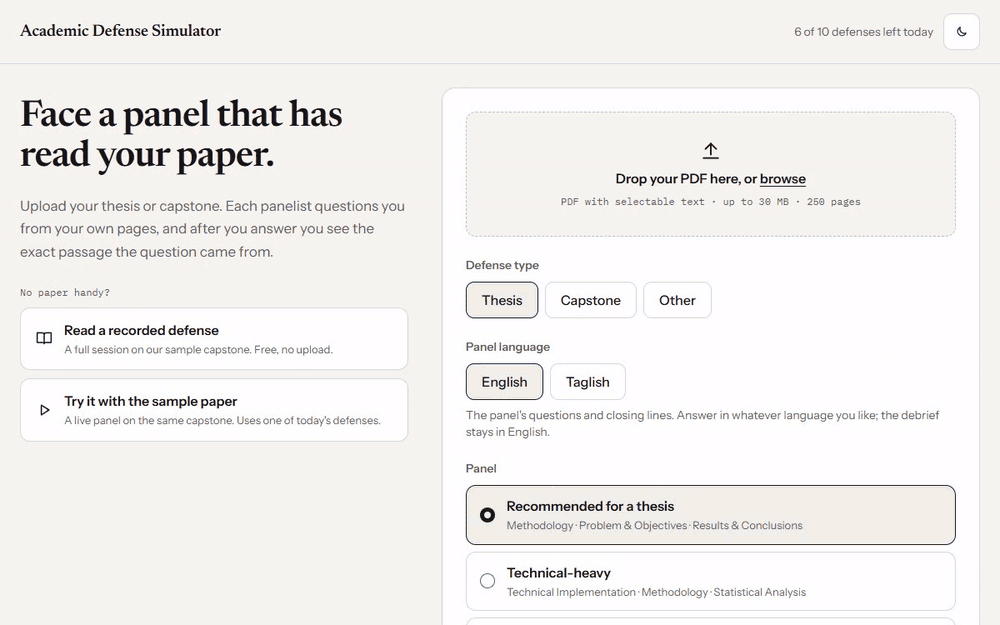
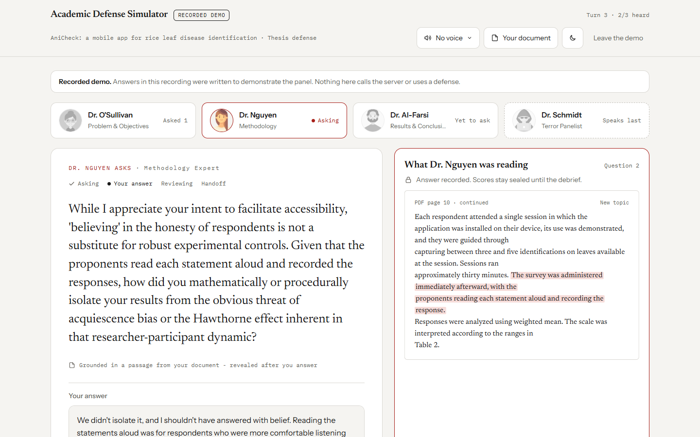
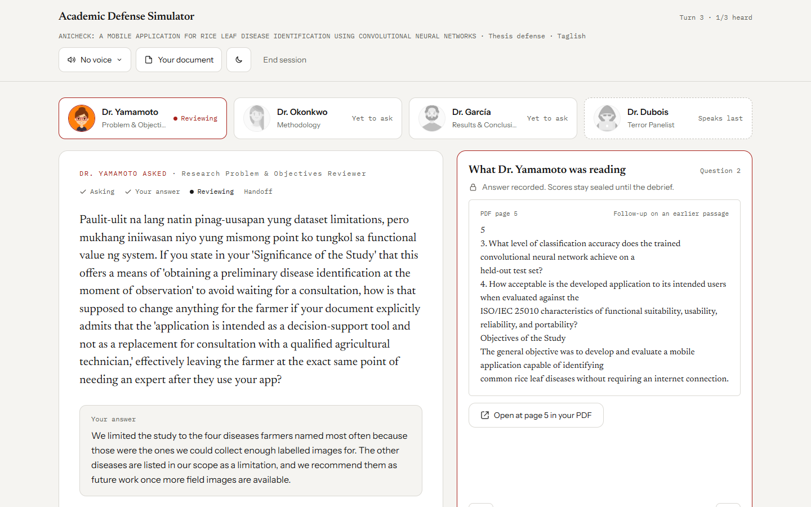
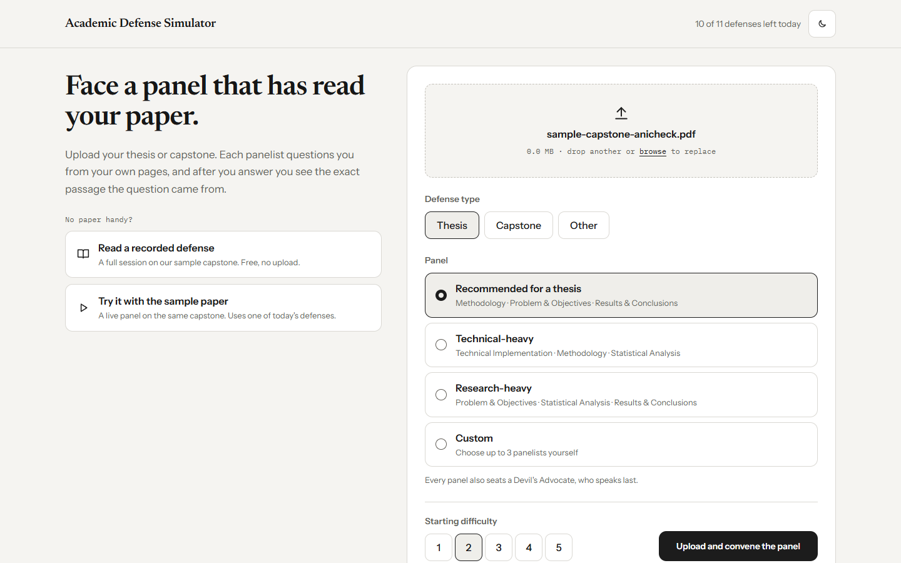
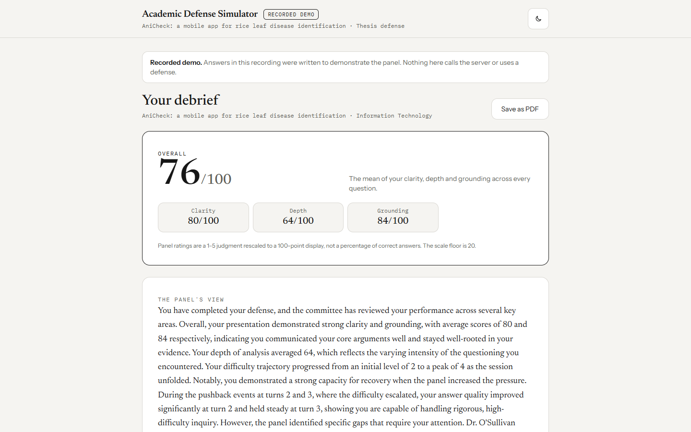

# Academic Defense Simulator

**Instead of searching your paper to answer your questions, the panel searches it to question you.**

Upload a thesis or capstone and defend it in front of a panel of AI examiners.
Each panelist retrieves a passage from your own pages, finds a claim, a number or a decision worth challenging, and asks about it.
After you answer, you see the exact passage and page the question came from.

**[Try it live →](https://academic-defense-simulator.onrender.com)** · no PDF needed: *Read a recorded defense* replays a real session in the real UI, instantly, with zero backend calls.



> The backend runs on Render's free tier and sleeps when idle, so the first visit of the day can take up to a minute ("Waking the panel").
> The shared demo allows 10 defenses a day, and 3 per IP address. Paste your own Gemini key on the start screen to skip both limits; it's held in server memory for that one defense and never logged (checked with a sentinel key: 0 occurrences across 549 log lines).

**[Read the case study →](docs/case-study.md)**: the evals, what they changed, and the finding a later eval walked back.

---

## Why this is interesting

**RAG, turned around.** Retrieval here feeds question generation only. The API's one free-text input is your answer, and it goes to scoring, never to retrieval. Every question carries a reference that's checked against the passage it was built on.

**Measured, not guessed.** Early panelists asked students about *other authors'* studies cited in their literature review as if that work were the student's own. I measured it (11 of 20 probe questions on literature-review passages got it wrong), an independent judge on a different model confirmed it, and I fixed it by routing: the panel no longer receives those passages. Then a chapter filter took opening rounds that walk forward through the paper from **5 of 10 to 10 of 10**.

**A panel, not a chatbot.** Each panelist has a lane (problem and objectives, methodology, results, and so on) and opens in its own chapter. A **Terror Panelist** speaks last and goes after the strongest claim you've made in the earlier answers. When a panelist hands off, it closes with one line of its own.

**It adapts, quietly.** Every answer is scored on clarity, depth and grounding against a rubric you never see. Answers with gaps draw follow-ups and raise the stakes. Scores stay sealed until the debrief.

**Taglish mode.** The panel can question you in Taglish. Scoring, the debrief and the suggestions stay in English, and a scoring-parity check on the same answers passed (mean difference +0.50 out of 15).

<p align="center">
  
  
</p>

## The panel

Pick a preset or build your own, up to three panelists. A Terror Panelist is always seated and always speaks last.

| Archetype | Lane |
|---|---|
| Research Problem & Objectives Reviewer | Problem statement, scope, whether the objectives line up |
| Methodology Expert | Research design, sampling, instruments |
| Technical Implementation Reviewer | Architecture, tooling, build decisions |
| Statistical & Data Analysis Reviewer | Analysis choices, inference, data handling |
| Results & Conclusions Reviewer | Whether the conclusions follow from the results |
| Ethics & Practicality Reviewer | Consent, risk, real-world deployability |
| Industry & Professional Practice Reviewer | Standards and professional relevance |
| Literature & Theory Specialist | Framing and theory (in no preset; see [limitations](#known-limitations)) |
| Terror Panelist | Contests your strongest claim using your earlier answers |

Defense types: thesis, capstone, and other (oral comps, scholarship panels, certification interviews, grant defenses). The type shapes which panelists are offered and how they frame questions.

## How it works

```
Browser ─ React 19 + TypeScript (Render static site)
   │  your PDF, your answers                ▲  questions, revealed passages, the debrief
   ▼                                        │
FastAPI ─ one worker, sessions in memory (Render free tier)
   │
   ├─ Ingest   PyMuPDF ─► drop navigation pages and the reference list ─► chunk
   │           ─► find chapters and the literature review ─► embed locally (MiniLM on ONNX)
   │
   ├─ Ask      panelist's focus query ─► numpy cosine over your paper's chunks
   │           ─► routing: literature-review passages are withheld
   │           ─► first question only: restricted to the panelist's home chapter
   │           ─► near-tie sampling, so sessions differ
   │           ─► Gemini writes one question grounded in that passage ─► grounding check
   │
   ├─ Answer   sealed score (clarity, depth, grounding) ─► follow-up, or hand-off with a closing line
   │
   └─ Debrief  scores, the panel's view, per-answer suggestions grounded in the same passages
                                                                  (gemini-2.5-flash)

Postgres on Neon holds one thing: the shared daily quota, reserved atomically.
```

Choices worth explaining:

- **Fresh prompts from typed state, not a replayed transcript.** Each call renders its prompt from a Pydantic session model, so a panelist's persona can't dilute over a long session.
- **Brute-force retrieval on purpose.** A paper is a few dozen chunks (the sample capstone yields 13). numpy cosine similarity is instant at that scale; a vector database would be complexity with no payoff.
- **Embeddings run locally.** MiniLM on ONNX Runtime, fetched and hash-checked at build time, so cold starts don't download weights and no embedding call touches an API.
- **The provider is isolated.** Only one module imports `google.genai`. Every LLM call goes through one choke point that counts calls and paces requests under the free tier's per-minute limit.
- **v2 wraps v1, it doesn't rewrite it.** The FastAPI backend runs the original engine. Prompt changes for Taglish went through a single language slot, and a golden test proves the English prompts are byte-for-byte unchanged.

<p align="center">
  
  
</p>

## What the evals changed

The decision record in [`docs/`](docs/) is the part I'd point at first. Every milestone has a decisions doc written before the work and a results doc with real command output after it. Pass rules are set before the data comes in, and they include a branch for "none of the above".

The clearest pattern across them: **changing what the model is given beat telling it to behave differently, every time I measured both.**

| Problem | Telling the model | Changing what it's given |
|---|---|---|
| Panelists treated cited studies as the student's own | A "this is cited work" note: 11 of 20 → 6 of 20 wrong | Withholding literature-review passages: the problem can't occur |
| Opening rounds jumped around the paper | Ordering speakers by chapter: 5 of 10 rounds walked forward | A home-chapter filter on the first question: 10 of 10 |
| Closing lines repeated themselves | "Vary the phrasing": 4–5 of 10 sessions varied | Showing the session's earlier lines: 10 of 10 |

The attribution counts come from a careful check that wasn't blind; the verdict that decided the fix came from the independent judge described below.

Some of the other things the record shows:

- **Retrieval was evaluated, and the eval found a different bug than expected.** Archetypes do retrieve different evidence (the median pair shares 1 of its top 5 passages). The real defect was that on one paper, 6 of 8 archetypes' best match was front matter, some of it a table of contents. Dropping navigation pages, and later the reference list, fixed it.
- **Embeddings match vocabulary, not position in the argument.** Before the chapter filter, the only Chapter 1 chunk ranked 6th of 13 for the Problem & Objectives query. That's why the fix was a filter and not a better query.
- **A finding I published, then walked back.** I designed the internal score as a correctness detector; a probe showed it detects concession instead. A second document didn't reproduce the key contrast, and the case study leads with the non-replication instead of burying it.
- **Model fitness tested per task.** The cheap model (`gemini-3.1-flash-lite`) was measured unfit for judgment work. The free tier can't afford `gemini-2.5-flash` for every turn, so it's spent on the suggestions.
- **Judging I couldn't do myself went to an independent judge.** For the attribution verdict, a fresh agent on a different model saw only the questions and passages, with the rubric verbatim.

## Known limitations

**Panel voices are slow.** Panelist voices run on Xiaomi's MiMo API and take about 7–15 seconds per question (a 7.9 s median when measured directly; 6.8–14.1 s on a live run). Voice is off until you choose it, and the browser's own voice or no voice are one click away.

**The panel doesn't question your literature review.** Withholding those passages fixed the attribution problem by removing the topic. The Literature & Theory Specialist is in no preset for that reason, and a Custom panel that seats it opens out of chapter order.

**The internal score didn't reproduce across documents.** The mechanism runs; its reliability is unestablished. Adaptive difficulty is implemented, not calibration-verified, and no figure is claimed for it.

**Per-answer scoring runs on the cheaper model**, the one measured unfit for judgment, because the free tier can't sustain `gemini-2.5-flash` on every turn. This is the single biggest thing a paid tier would change.

**The grounding check has a false-negative mode.** It matches one contiguous span, so a question that correctly cites two figure captions or two cells of a table fails the check while being accurate. The fix is widening the schema's single reference field.

**The embedder sees only part of most chunks.** MiniLM stops at 256 tokens, and most chunks run past it; on the eval papers it saw about half to two thirds of the average chunk.

**Taglish turn 1 usually starts in English.** A v1 prompt rule asks every question to open with a lead-in clause, and that clause comes out in English. Text-to-speech may also mispronounce Filipino.

**Refreshing the page loses the defense on screen.** The server still holds the session; the frontend doesn't resume it yet.

**Chapter-aware openings need readable chapter headings.** Without them, nothing is filtered and openers fall back to plain retrieval.

## Stack

**Backend:** Python 3.13 · FastAPI · Pydantic · Gemini API (`google-genai`) · MiniLM on ONNX Runtime · numpy · PyMuPDF · Postgres on Neon (`psycopg`) · Xiaomi MiMo TTS
**Frontend:** React 19 · TypeScript · Vite 8 · Tailwind 4 · GSAP
**Hosting:** Render (backend, static site, and a redirect)

**Tests:** 632 backend (pytest), 293 frontend (Vitest), plus the v1 engine's 410. One v1 test fails on a fresh clone because it reads a gitignored local session fixture; it's logged in [`docs/ROADMAP.md`](docs/ROADMAP.md) instead of being skipped.

## Run it locally

You need Python 3.13, Node 20.19 or later, a Gemini API key, and a Postgres database for the daily quota (a free Neon database works; the table is created on first run).

**Backend**, from the repo root:

```bash
python -m venv backend/.venv
backend/.venv/bin/pip install -r backend/requirements.txt   # Windows: backend\.venv\Scripts\pip
backend/.venv/bin/python -m backend.fetch_model             # downloads and hash-checks MiniLM
```

Create `backend/.env`:

```
GEMINI_API_KEY=your-key
DATABASE_URL=postgresql://...
ADS_CORS_ORIGINS=http://localhost:5173
# Optional: MIMO_API_KEY=... for panel voices
```

Then run it with exactly one worker, since sessions live in memory:

```bash
backend/.venv/bin/uvicorn backend.app:app --port 8000 --workers 1
```

**Frontend**, from `frontend/`:

```bash
npm ci
cp .env.example .env.local   # points the app at http://localhost:8000
npm run dev                  # http://localhost:5173
```

The original Streamlit version (v1) still runs with `streamlit run academic_defense_simulator/streamlit_app.py`.

## What's next

v2.1 is parked in the [ROADMAP](docs/ROADMAP.md). The main items: faster voice, a Literature Specialist with real access to the literature, a fix for Custom panels' opening order, resuming a defense after a refresh, Taglish from the first question, and widening the grounding reference.

---

Built by **Sean Silver Allata**, BS Computer Science, Technological Institute of the Philippines.
[GitHub](https://github.com/slvr123) · [LinkedIn](https://www.linkedin.com/in/sean-silver-allata-9b1885395/)
