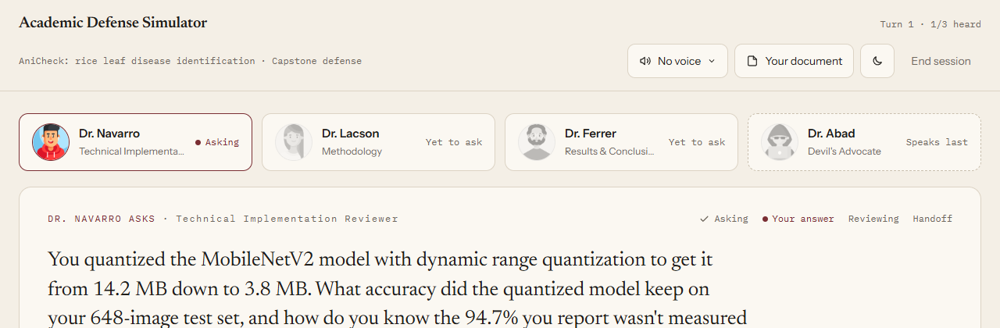
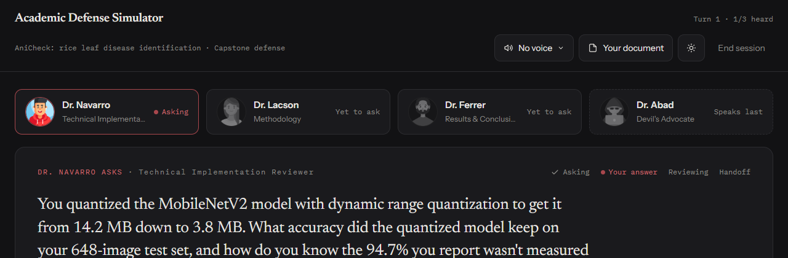
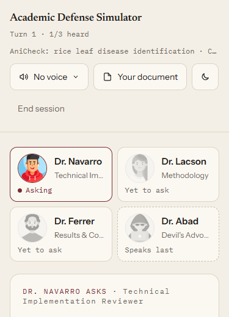
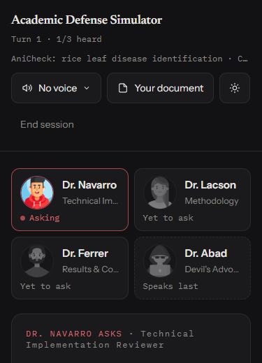
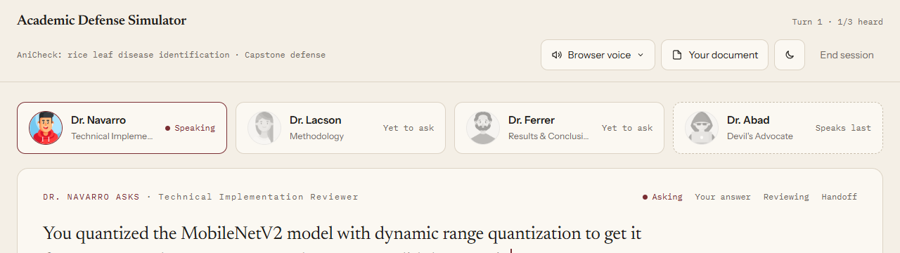
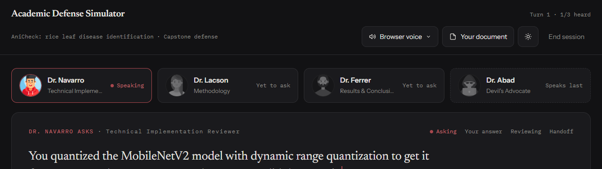
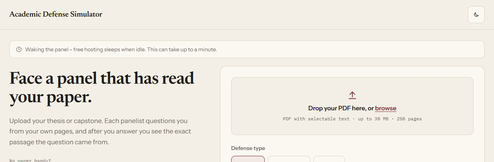

# v2.0 M12 - Pre-Launch Polish: Results

**Branch:** `v2.0-m12`, merged to `main` on 2026-11-03.
**Decisions:** [`v2.0-m12-decisions.md`](v2.0-m12-decisions.md).
**Stop points:** none hit.
A, B and C each checked out clean; the evidence is in sections 1 and 5.

Claude ran M12 end to end from my decisions doc.
Where it made a call the doc didn't cover, or found the doc's premise didn't match the code, that's marked **Flag** below with the reason.

## 0. Summary

| Item | Outcome |
|---|---|
| D1 opening order | Shipped on the v2 side, no v1 edit (stop point A clear) |
| D1 measurement | **5 of 10** rounds pass, under the 8 of 10 bar: ordering shipped anyway, chapter-biased filter parked as M14 |
| D1 preset check | `problem_objectives_reviewer` **is** in the recommended thesis preset |
| D1 demo re-record | **0 attempts, old demo kept.** It already passes both keep criteria and already shows the new order (Flag 1) |
| D2 header | Title left, `Turn n · k/3 heard` right, one baseline; wraps left-aligned on phones |
| D3 glow | Zero elements with a computed shadow or blur, in both themes, speaking card included |
| D4 themes | Paper default, Chamber by toggle, persisted with a Paper fallback; 58 contrast pairs, 0 failing |
| D5 cold starts | Demo makes 0 backend calls (stop point B clear); `/status` doesn't touch Neon (stop point C clear); waking line after 3 s; the frontend is a static site |

## 1. D1 - the opening round

### Where it lives

v1's `select_active_panelist` (`academic_defense_simulator/engine.py:63-85`) opens new topics in the order the domain panelists sit in `session.panel`:

```python
domain_panelists = [p for p in session.panel if p.archetype_key != DEVILS_ADVOCATE_KEY]
...
return domain_panelists[len(session.used_chunk_indices) % len(domain_panelists)]
```

So reordering the seated panel before it reaches v1 orders round one, and stop point A doesn't apply.
`backend/opening_order.py` holds the home-chapter map (exact keys) and `opening_order()`, a stable sort of the domain panelists by home chapter with the Devil's Advocate last.
`backend/defense.py` applies it to the panel `generate_panel` returns.
Persona generation still sees the roster in its usual `PANEL_COMPOSITION` order, so its prompt input is unchanged.
After round one the engine's follow-up and rotation logic runs untouched.
`git diff main -- academic_defense_simulator/` is empty.

**Flag 2:** `/panel-options` now carries `home_chapter` per archetype (null for the Devil's Advocate), which the doc didn't ask for.
The preparing screen seats the panel from `/panel-options` before `/start` answers and lights the first seat as the opener.
Without the field it would have shown the old roster order and contradicted the real first speaker.
The frontend sorts by `home_chapter`, so the backend stays the only copy of the map.
The OpenAPI types were regenerated with `gen-api.mjs`; the only change is the new field.

### Preset check

`frontend/src/lib/presets.ts`:

```ts
thesis: ['methodology_expert', 'problem_objectives_reviewer', 'results_conclusions_reviewer'],
```

`problem_objectives_reviewer` is in the recommended thesis preset.
Seated by `opening_order`, that panel opens Problem & Objectives, then Methodology, then Results & Conclusions, then the Devil's Advocate.
Presets unchanged.

### Tests

`backend/tests/test_opening_order.py`, 8 tests:
- every archetype has a home chapter;
- the thesis preset opens at Chapter 1;
- ties keep their order in both directions, including a two-way Chapter 5 tie;
- the Devil's Advocate is last wherever it was seated;
- an unmapped key is refused;
- v1's unchanged `select_active_panelist` follows the seated order through four turns;
- `/start` seats the panel and asks the Chapter 1 reviewer first;
- `/panel-options` carries each home chapter.

`frontend/src/lib/panel.test.ts` covers the preparing screen's order and a capstone tie.

### The measurement

`scripts/measure_opening_order.py` runs each defense in-process through the backend's own `setup_defense` and `ask()`, so the seated order is the product's.
It generates the opening round only.
Between questions the open turn is recorded with a synthetic strong score (no LLM call), so v1 opens the next panelist's topic as it would after a strong answer.
That turn's summary, "(not answered: opening-round measurement)", reaches the next question's cross-panelist digest.
It doesn't affect retrieval, which runs on each panelist's focus query.

- Panel: the recommended thesis preset, defense type thesis.
- Model: `gemini-3.1-flash-lite`, never switched.
- Chapter map: built from each PDF's own `CHAPTER n` headings.
  Only pages with exactly one heading count, so the table-of-contents pages are skipped.
  AniCheck: `{1: 4, 2: 6, 3: 8, 4: 11, 5: 14}`.
  sample3: `{1: 5, 2: 13, 3: 43}`; it has three chapters, so everything from page 43 counts as Chapter 3.
- Second document: `sample3.pdf`, from the eval set (`probe_question_gen_v0.4_sample3_results.jsonl`).
  Its headings were detectable, so no substitute was needed.
  Its domain and topic were extracted at setup, so no document text sits in the script.
- Spend: 10 sessions, 71 Gemini calls in all.
  Session 10 hit six 503s in a row; the script waited 60 s between tries and went through on the eighth attempt.

Raw output:

```
AniCheck: chapter starts {1: 4, 2: 6, 3: 8, 4: 11, 5: 14}
  AniCheck #1 FAIL: problem_objectives_reviewer p13 ch4 -> methodology_expert p15 ch5 -> results_conclusions_reviewer p12 ch4 (6 calls)
  AniCheck #2 FAIL: problem_objectives_reviewer p15 ch5 -> methodology_expert p13 ch4 -> results_conclusions_reviewer p11 ch4 (4 calls)
  AniCheck #3 FAIL: problem_objectives_reviewer p13 ch4 -> methodology_expert p15 ch5 -> results_conclusions_reviewer p12 ch4 (4 calls)
    ask failed (LLMProviderError); waiting 10s, attempt 1
  AniCheck #4 FAIL: problem_objectives_reviewer p13 ch4 -> methodology_expert p15 ch5 -> results_conclusions_reviewer p11 ch4 (7 calls)
  AniCheck #5 FAIL: problem_objectives_reviewer p15 ch5 -> methodology_expert p13 ch4 -> results_conclusions_reviewer p11 ch4 (4 calls)
sample3: chapter starts {1: 5, 2: 13, 3: 43}
  sample3 #1 PASS: problem_objectives_reviewer p6 ch1 -> methodology_expert p56 ch3 -> results_conclusions_reviewer p61 ch3 (5 calls)
  sample3 #2 PASS: problem_objectives_reviewer p6 ch1 -> methodology_expert p56 ch3 -> results_conclusions_reviewer p61 ch3 (5 calls)
  sample3 #3 PASS: problem_objectives_reviewer p6 ch1 -> methodology_expert p43 ch3 -> results_conclusions_reviewer p56 ch3 (6 calls)
  sample3 #4 PASS: problem_objectives_reviewer p6 ch1 -> methodology_expert p43 ch3 -> results_conclusions_reviewer p56 ch3 (7 calls)
    ask failed (LLMProviderError); waiting 10s, attempt 1
    ask failed (LLMServiceUnavailableError); waiting 60s, attempt 2
    ask failed (LLMServiceUnavailableError); waiting 60s, attempt 3
    ask failed (LLMServiceUnavailableError); waiting 60s, attempt 4
    ask failed (LLMServiceUnavailableError); waiting 60s, attempt 5
    ask failed (LLMServiceUnavailableError); waiting 60s, attempt 6
    ask failed (LLMServiceUnavailableError); waiting 60s, attempt 7
    ask failed (LLMServiceUnavailableError); waiting 60s, attempt 1
  sample3 #5 PASS: problem_objectives_reviewer p6 ch1 -> methodology_expert p43 ch3 -> results_conclusions_reviewer p56 ch3 (23 calls)
5 of 10 opening rounds pass
```

| # | Document | Speaking order | Q1 page / ch | Q2 page / ch | Q3 page / ch | Result |
|---|---|---|---|---|---|---|
| 1 | AniCheck | Problem, Methodology, Results | 13 / 4 | 15 / 5 | 12 / 4 | FAIL |
| 2 | AniCheck | Problem, Methodology, Results | 15 / 5 | 13 / 4 | 11 / 4 | FAIL |
| 3 | AniCheck | Problem, Methodology, Results | 13 / 4 | 15 / 5 | 12 / 4 | FAIL |
| 4 | AniCheck | Problem, Methodology, Results | 13 / 4 | 15 / 5 | 11 / 4 | FAIL |
| 5 | AniCheck | Problem, Methodology, Results | 15 / 5 | 13 / 4 | 11 / 4 | FAIL |
| 6 | sample3 | Problem, Methodology, Results | 6 / 1 | 56 / 3 | 61 / 3 | PASS |
| 7 | sample3 | Problem, Methodology, Results | 6 / 1 | 56 / 3 | 61 / 3 | PASS |
| 8 | sample3 | Problem, Methodology, Results | 6 / 1 | 43 / 3 | 56 / 3 | PASS |
| 9 | sample3 | Problem, Methodology, Results | 6 / 1 | 43 / 3 | 56 / 3 | PASS |
| 10 | sample3 | Problem, Methodology, Results | 6 / 1 | 43 / 3 | 56 / 3 | PASS |

Every session seated `problem_objectives_reviewer, methodology_expert, results_conclusions_reviewer, devils_advocate`, so the ordering itself held every time.
The full rows are in `evals/v2.0-m12-opening-order.json`: keys, pages and chapters only, and its longest string is a 36-character session id.

**Rule applied:** 5 is under 8, so the ordering ships and the chapter-biased retrieval filter is parked as M14 in `docs/ROADMAP.md`.
All five failures are AniCheck, and they share one pattern.
On a 16-page sample, the Problem & Objectives Reviewer's focus query lands on Chapters 4-5, where the objectives come back as findings and conclusions.
On sample3, a real 82-page document, the same reviewer landed on page 6 (Chapter 1) every time.
That's the gap a chapter-biased filter would close.

### Re-recording the demo - Flag 1

**0 attempts made; the old demo is kept.**
The decisions doc says the recorded demo had the Methodology Expert opening while the Problem & Objectives Reviewer sat on the panel.
The shipped recording doesn't match that.
It uses the recommended **capstone** panel, which has no Problem & Objectives Reviewer, and its seat order is already what `opening_order` produces:

```
recorded seat order : ['technical_implementation_reviewer', 'methodology_expert', 'results_conclusions_reviewer', 'devils_advocate']
opening_order of it : ['technical_implementation_reviewer', 'methodology_expert', 'results_conclusions_reviewer', 'devils_advocate'] same
recorded opening round: [(1, 'technical_implementation_reviewer', 10, 3), (2, 'methodology_expert', 13, 4), (3, 'results_conclusions_reviewer', 15, 5)] PASS
answers (turn, total/15, next question origin): [(1, 13, 'new_topic'), (2, 15, 'new_topic'), (3, 5, 'follow_up'), (4, 3, 'follow_up'), (5, 14, 'devils_advocate'), (6, 14, None)]
```

It already meets both keep criteria:
- (a) its opening round passes, Chapter 3 to 4 to 5;
- (b) the 5/15 and 3/15 answers each drew a follow-up.

Re-recording the same panel can only reproduce the same order.
Re-recording with the Problem & Objectives Reviewer would very likely fail (a): that reviewer's AniCheck question landed in Chapter 4 or 5 in all five measured sessions.
Either way the result would have been "keep the old demo", so Claude spent none of the three attempts.
If I want the demo to open at Chapter 1, that waits on M14's filter.

## 2. D2 - the session header

The title sits on the left and `Turn n · k/3 heard` on the right, on the title's baseline (`items-baseline`).
`k` counts the distinct domain panelists who have asked so far, the open question's asker included.
The `3` is the number of domain panelists seated; the Devil's Advocate counts on neither side.
"Question n" and its dashes are gone.
The subtitle and the controls (voice, Your document, the theme toggle, End session) sit on a second row.
On phones both rows wrap left-aligned.
The demo header gets the same layout.

**Flag 3:** "Turn n · k/3 heard" is the decisions doc's wording, but nothing in the code produced it before, so Claude defined `k` and the total as above.

Before the fix, "Question 1" floated mid-header at 1280 px and dropped onto its own line between the title and the controls on a phone.

Measured in Chrome by `scripts/screens_m12.py`; a zero-size inline-block probe gives each element's baseline y:

```
ok   header paper 1280: data-theme=(none: Paper); 'Turn 1 · 1/3 heard' on the title's line, baselines 35.0/35.0, 0.0px from the right edge
ok   no sideways scroll paper 1280: scrollWidth=1280 innerWidth=1280
ok   header paper 375: data-theme=(none: Paper); 'Turn 1 · 1/3 heard' wrapped under the title, left edge 16.0 = row 16.0 (left-aligned)
ok   no sideways scroll paper 375: scrollWidth=375 innerWidth=375
ok   header chamber 1280: data-theme=chamber; 'Turn 1 · 1/3 heard' on the title's line, baselines 35.0/35.0, 0.0px from the right edge
ok   no sideways scroll chamber 1280: scrollWidth=1280 innerWidth=1280
ok   header chamber 375: data-theme=chamber; 'Turn 1 · 1/3 heard' wrapped under the title, left edge 16.0 = row 16.0 (left-aligned)
ok   no sideways scroll chamber 375: scrollWidth=375 innerWidth=375
```

Paper, desktop:



Chamber, desktop:



Phone, Paper and Chamber:

 

## 3. D3 - no glow

Removed:
- the speaking portrait's breathing `box-shadow` ring (`@keyframes speaking`, `--animate-speaking`) and its reduced-motion `ring-4 ring-accent/40`;
- the voice menu's `shadow-[0_18px_40px_rgba(0,0,0,0.45)]`;
- the source passage card's soft drop shadow, replaced by a 1px `border-paper-edge`;
- the tinted fill on the lit panel card and the first preparing seat; the active state is now a 1px solid accent border on the plain surface.

Kept: focus rings (outlines, for accessibility), the opacity pulse on status dots, the typewriter caret, and the "Reviewing" shimmer, which is a text-colour band with no blur.
The GSAP choreography is unchanged.
No tween animated a glow property, and every tween already ends in an explicit state (the M11.1 lesson).

Computed style in Chrome while the lit panelist is speaking (a stand-in `speechSynthesis` keeps the browser voice speaking), scanning every element on the page:

```
ok   speaking card paper: card border 1px solid rgb(122, 46, 51), box-shadow none; portrait box-shadow none, filter none, animation none, data-speaking=true
ok   no glow anywhere paper: 0 element(s) with a shadow or blur
ok   speaking card chamber: card border 1px solid rgb(168, 71, 77), box-shadow none; portrait box-shadow none, filter none, animation none, data-speaking=true
ok   no glow anywhere chamber: 0 element(s) with a shadow or blur
```

The built CSS has no `text-shadow` or `blur(`.
Its two `box-shadow` declarations belonged to Tailwind's `.ring` utility, generated from the word "ring" in an Avatar comment that no element used; Claude reworded the comment.
Its `drop-shadow` hits are Tailwind's empty filter-stack defaults behind `grayscale`, not glows.

Tests:
- `App.theme.test.tsx` checks the speaking card's classes: a 1px solid accent border, and no shadow, ring, blur or speaking-animation class on it or its children.
- `screens_m12.py` checks the computed style above.





## 4. D4 - Paper and Chamber

### Audit first

Before any change, a grep over `frontend/src`, `index.html`, `og/` and `public/*.svg` for hex, `rgb(` and `rgba(` outside `src/index.css`:

| Location | Hits | Outcome |
|---|---|---|
| `DefenseScreens.tsx:187,195` | 2 | `&#9654;`, an HTML entity (▶), not a colour |
| `SessionHeader.tsx:139` | 1 | `rgba` menu shadow: removed (D3) |
| `Sources.tsx:21` | 1 | `rgba` passage shadow: removed (D3) |
| `index.html:8` | 1 | Bench `theme-color`: now Paper `#F4EFE6`, switched to `#121214` for Chamber |
| `og/og-image.html` | 18 | **Exception:** the OG source, regenerated in M13 |
| `public/favicon.svg` | 6 | Bench amber: redrawn in oxblood (Flag 4) |

Also checked:
- GSAP tweens: none animate a colour.
- Avatars: PNGs, not inline SVG.
- The PDF side panel and the transcript drawer: tokens only.
- The printable report: light in both themes; `@media print` now covers `:root[data-theme="chamber"]` too.

After M12, the only raw colours left outside the token file are the theme-colour pair in `src/lib/theme.ts` and `index.html` (a `<meta>` tag can't read a CSS variable), the 18 OG hits, and the new favicon.

**Flag 4:** the doc doesn't mention the favicon, but it was Bench's amber, which the doc retires.
It's now an oxblood tile with an on-accent mark.
`favicon-32.png` and `apple-touch-icon.png` were re-rendered from it; `og-image.png` was **not** (that's M13).

### Implementation

- In `src/index.css`, `@theme` holds Paper, so every `--color-*` is a CSS variable on `:root`, and `:root[data-theme="chamber"]` redefines them.
  Bench is gone.
- The doc's eight roles per theme map onto the existing finer tokens; for example `muted`, `subtle` and `faint` all take the muted value.
  A new `accent-text` token holds Chamber's separate accent-as-text shade, and the 11 `text-accent` uses became `text-accent-text`.
- **Flag 5, derived shades the doc doesn't list**, each checked by the script below:
  - `accent-hover`: Paper `#62242A`, Chamber `#963F45`;
  - `accent-soft`, for selected presets and hovered rows: `#F3E9E4` / `#241B1D`;
  - `rail`, the disabled button: `#EEE8DD` / `#202023`;
  - `highlight`, the passage mark: `#ECD6D2` / `#4A2A2E`;
  - the notice tints.

  The source passage card, Bench's "paper", now takes each theme's surface colour.
- `ThemeToggle.tsx` sits in every header: an icon button labelled "Dark theme", with `aria-pressed` set when Chamber is on.
- `src/lib/theme.ts` keeps the choice in `localStorage` under `ads-theme`.
  Every read and write is wrapped in try/catch, and any failure or unknown value means Paper.
  An inline script in `index.html` applies Chamber before first paint, so a returning Chamber visitor sees no flash of Paper.
  The OS colour scheme is never consulted.
- Fonts unchanged.

### Contrast, re-verified

`python scripts/check_contrast.py`, rewritten for both themes plus print.
It reproduces every ratio in the decisions doc: Paper 14.68, 5.27, 4.88, 8.74 and 8.74; Chamber 15.0, 5.03, 4.67, 5.0 and 3.04.
The Devil's Advocate's dashed border is reported, not required: 1.72 on Paper, 1.25 on Chamber.
That's the doc's own palette, and the card also says "Speaks last".

```
theme    foreground    background    ratio  bar  use
paper    ink           ground        14.68  4.5  page text ok
paper    ink           card          15.86  4.5  card text, questions ok
paper    ink           field         14.68  4.5  answer box text ok
paper    ink           accent-soft   14.08  4.5  selected preset, hovered menu row ok
paper    ink-dim       field         14.68  4.5  your answer, recorded ok
paper    muted         card           5.27  4.5  secondary text on cards, panel card role and status ok
paper    muted         ground         4.88  4.5  header metadata ok
paper    muted         field          4.88  4.5  score labels, drop zone limits ok
paper    muted         accent-soft    4.68  4.5  pressed preset's members ok
paper    accent-text   card           8.74  4.5  'Dr. X asks', current step, 'Speaking' ok
paper    accent-text   ground         8.09  4.5  'Recorded demo' badge, drop zone 'browse' ok
paper    accent-text   accent-soft    7.76  4.5  'Overall' label ok
paper    ink           card          15.86  4.5  shimmer band passing over 'Reviewing' ok
paper    on-accent     accent         8.74  4.5  primary button ok
paper    on-accent     accent-hover  10.97  4.5  primary button, hover ok
paper    muted         rail           4.58  4.5  disabled button ok
paper    paper-ink     paper         15.86  4.5  source passage ok
paper    paper-ink     highlight     12.10  4.5  highlighted reference ok
paper    paper-muted   paper          5.27  4.5  passage page label ok
paper    ink           warn-soft     14.23  4.5  notice text ok
paper    ink           danger-soft   13.59  4.5  error notice text ok
paper    danger        ground         6.57  4.5  'no defenses left' line ok
paper    accent        card           8.74  3.0  lit card border, focus ring (non-text) ok
paper    accent        ground         8.09  3.0  focus ring on the page (non-text) ok
paper    devil-line    surface        1.72   -   Devil's Advocate dashed card (decorative) reported
chamber  ink           ground        15.00  4.5  page text ok
chamber  ink           card          13.92  4.5  card text, questions ok
chamber  ink           field         15.00  4.5  answer box text ok
chamber  ink           accent-soft   13.47  4.5  selected preset, hovered menu row ok
chamber  ink-dim       field         15.00  4.5  your answer, recorded ok
chamber  muted         card           5.03  4.5  secondary text on cards, panel card role and status ok
chamber  muted         ground         5.41  4.5  header metadata ok
chamber  muted         field          5.41  4.5  score labels, drop zone limits ok
chamber  muted         accent-soft    4.86  4.5  pressed preset's members ok
chamber  accent-text   card           4.67  4.5  'Dr. X asks', current step, 'Speaking' ok
chamber  accent-text   ground         5.03  4.5  'Recorded demo' badge, drop zone 'browse' ok
chamber  accent-text   accent-soft    4.52  4.5  'Overall' label ok
chamber  ink           card          13.92  4.5  shimmer band passing over 'Reviewing' ok
chamber  on-accent     accent         5.00  4.5  primary button ok
chamber  on-accent     accent-hover   5.94  4.5  primary button, hover ok
chamber  muted         rail           4.70  4.5  disabled button ok
chamber  paper-ink     paper         13.92  4.5  source passage ok
chamber  paper-ink     highlight     10.13  4.5  highlighted reference ok
chamber  paper-muted   paper          5.03  4.5  passage page label ok
chamber  ink           warn-soft     13.13  4.5  notice text ok
chamber  ink           danger-soft   13.35  4.5  error notice text ok
chamber  danger        ground         8.35  4.5  'no defenses left' line ok
chamber  accent        card           3.04  3.0  lit card border, focus ring (non-text) ok
chamber  accent        ground         3.27  3.0  focus ring on the page (non-text) ok
chamber  devil-line    surface        1.25   -   Devil's Advocate dashed card (decorative) reported
print    ink           card          21.00  4.5  print: body text ok
print    muted         card          10.86  4.5  print: secondary text ok
print    subtle        card           8.86  4.5  print: labels ok
print    paper-ink     paper         21.00  4.5  print: source passage ok
print    paper-ink     highlight     14.88  4.5  print: highlighted reference (also underlined) ok
print    paper-muted   paper         10.86  4.5  print: passage page label ok
print    accent        card          21.00  4.5  print: 'Overall' label ok
print    ink           accent-soft   21.00  4.5  print: a question's Overall score tile ok
print    accent        accent-soft   21.00  4.5  print: the tile's 'Overall' label ok
print    line-strong   card           5.33  3.0  print: card borders (non-text) ok
58 required pairs, 0 failing
```

The first run failed three derived shades (Chamber hover 4.25, the disabled rail 3.76 and 4.02); they were tuned to the values above.
The shimmer band now uses the text colour instead of the hover shade, which read too dark on Chamber.

Tests:
- `theme.test.ts`: Paper on a first visit and for unknown values (`bench` included); Chamber read back; a throwing storage falls back to Paper and never throws on write; the attribute and `theme-color` are set.
- `App.theme.test.tsx`: the toggle turns Chamber on and off with persistence, reads the pre-paint attribute, and still switches when `setItem` throws.

## 5. D5 - cold starts

### 1. The demo makes zero backend calls - stop point B clear

`screens_m12.py` logs every request to the API origin, clicks "Read a recorded defense" and steps through all 7 screens to the debrief.
It runs twice: once with the canned API answering, and once with every API request refused, as if the backend were down.

```
ok   demo answered: page load sent 3 backend request(s) ['GET http://api.test/panel-options', 'GET http://api.test/quota', 'GET http://api.test/status']; the demo, 7 Next clicks to the debrief, sent 0
ok   demo refused: page load sent 1 backend request(s) ['GET http://api.test/status']; the demo, 7 Next clicks to the debrief, sent 0
```

The page-load requests are the pre-wake and what follows it, not the demo.
The demo reads its recording from the static site (`/demo/anicheck-defense.json`).
The existing vitest `App.demo.test.tsx` asserts the same.

### 2. Pre-wake

This already existed: on page load `useFlow` calls the waker, which sends `GET /status` (with retries) and blocks neither the start screen nor the demo.
M12 adds one thing: a wake more than 14 minutes after the server last answered probes again (`STALE_AFTER_MS`, just under Render's 15).
So someone who idles on the start screen and then uploads sees the waking state, not a silent upload stuck at 0%.

### 3. The waking line

Any wake unanswered for 3 s (`WAKING_NOTICE_MS`) sets `waking`.
The start screen then shows a calm line with a static clock icon (`role="status"`, no spinner, no pulse), and the upload screen shows the same text on its card.
Both clear when the server answers, and the form and the demo stay usable throughout.

**Flag 6:** the doc's copy has an em dash; under my no-em-dash rule it reads "Waking the panel - free hosting sleeps when idle. This can take up to a minute."

```
ok   waking paper: line absent at 2.5 s (0 found), shown by 3.3 s after navigation; demo button enabled=True
ok   waking chamber: line absent at 2.5 s (0 found), shown by 3.3 s after navigation; demo button enabled=True
```



Tests:
- `App.frontDoor.test.tsx`: the line is absent at 2.9 s and present at 3.1 s, with the form and the sample button enabled, and gone once `/status` answers; it never shows when `/status` answers at once.
- `serverWaker.test.ts`: the waker probes again only after `STALE_AFTER_MS`.

### 4. What `/status` does - stop point C clear

`backend/app.py:212-217`:

```python
def health() -> HealthResponse:
    return HealthResponse(model_loaded=app.state.embedder is not None, tts_available=settings.mimo_key is not None)

app.get("/status", response_model=HealthResponse)(health)
```

It reads two in-memory attributes and touches no database.
The only middleware is CORS, which doesn't touch the store either.
`backend/tests/test_status_keep_alive.py` swaps in a store that records every call.
Five `/status` requests record nothing, while one `/quota` records `used`, which shows the probe is live:

```
backend/.venv/Scripts/python -m pytest backend/tests/test_status_keep_alive.py -q
.                                                                        [100%]
1 passed in 3.32s
```

**Flag 7, an adjacent risk (not a stop point):** `/status` doesn't touch Neon, but keeping the process up 18 hours a day changes what the quota pool does in the background.
`PostgresQuotaStore` opens a `psycopg_pool.ConnectionPool` with `min_size=1` and the library's default `max_lifetime`:

```
psycopg_pool 3.3.3 {'min_size': 4, 'max_lifetime': 3600.0, 'max_idle': 600.0, 'reconnect_timeout': 300.0}
```

The pool replaces its one idle connection about once an hour, and opening a connection through Neon's proxy can wake a suspended compute.
Today the process sleeps after 15 idle minutes, so this rarely comes up.
With the pinger running, it could wake Neon around 18 times a day for nothing.
I didn't change it in M12.
After the pinger has run a few days, I'll check Neon's compute hours.
If they climb, the fix is a pool that holds no idle connection (`min_size=0`) or a much longer `max_lifetime`, a one-line change in `backend/quota.py`.

### 5. `render.yaml`

```yaml
  - type: web
    name: ads-frontend
    runtime: static
```

The frontend is a **static site**, so it never spins down and uses none of the 750 free web-service hours.
Only `ads-backend` (`type: web`, `runtime: python`, `plan: free`) counts.
The hours math stands: 18 h × 31 days = 558 h of 750.

## 6. Done means

All suites, run one at a time:

```
backend  (backend/.venv, backend/tests)   508 passed, 8 skipped in 178.45s (0:02:58)
v1       (.venv, tests/)                  1 failed, 409 passed in 23.85s
         FAILED tests/test_persistence.py::test_real_pre_existing_file_missing_answer_suggestions_loads_with_defaults
vitest   --no-file-parallelism            Test Files  20 passed (20)
                                               Tests  253 passed (253)
tsc -b   TypeScript: No errors found
build    dist/assets/index-Bhie7CbN.css   33.31 kB │ gzip:  7.48 kB
         dist/assets/index-C1i0HqcO.js   388.85 kB │ gzip: 123.67 kB
contrast 58 required pairs, 0 failing
browser  scripts/screens_m12.py: 0 check(s) failed (16 checks)
```

The v1 failure is the one M11's baseline already recorded, and v1 is unchanged.
Backend went from 499 tests on `main` to 508 (9 new); vitest from 238 to 253 (15 new).

- [x] All existing tests pass (apart from v1's one pre-existing failure).
- [x] New tests cover opening-round ordering with ties and the Devil's Advocate last, the theme toggle and its persistence fallback, and no glow on the speaking card (classes in vitest, computed style in Chrome).
- [x] Header verified at desktop and phone widths, screenshots in section 2.
- [x] Measurement table in place, rule applied: 5/10, ordering shipped, M14 parked.
- [x] Demo re-record outcome recorded: 0 attempts, old demo kept (Flag 1).
- [x] No stop point hit, so the merge to `main` went ahead.

The full browser run, `scripts/screens_m12.py`, which sections 2-5 quote:

```
ok   header paper 1280: data-theme=(none: Paper); 'Turn 1 · 1/3 heard' on the title's line, baselines 35.0/35.0, 0.0px from the right edge
ok   no sideways scroll paper 1280: scrollWidth=1280 innerWidth=1280
ok   header paper 375: data-theme=(none: Paper); 'Turn 1 · 1/3 heard' wrapped under the title, left edge 16.0 = row 16.0 (left-aligned)
ok   no sideways scroll paper 375: scrollWidth=375 innerWidth=375
ok   header chamber 1280: data-theme=chamber; 'Turn 1 · 1/3 heard' on the title's line, baselines 35.0/35.0, 0.0px from the right edge
ok   no sideways scroll chamber 1280: scrollWidth=1280 innerWidth=1280
ok   header chamber 375: data-theme=chamber; 'Turn 1 · 1/3 heard' wrapped under the title, left edge 16.0 = row 16.0 (left-aligned)
ok   no sideways scroll chamber 375: scrollWidth=375 innerWidth=375
ok   speaking card paper: card border 1px solid rgb(122, 46, 51), box-shadow none; portrait box-shadow none, filter none, animation none, data-speaking=true
ok   no glow anywhere paper: 0 element(s) with a shadow or blur
ok   speaking card chamber: card border 1px solid rgb(168, 71, 77), box-shadow none; portrait box-shadow none, filter none, animation none, data-speaking=true
ok   no glow anywhere chamber: 0 element(s) with a shadow or blur
ok   demo answered: page load sent 3 backend request(s) ['GET http://api.test/panel-options', 'GET http://api.test/quota', 'GET http://api.test/status']; the demo, 7 Next clicks to the debrief, sent 0
ok   demo refused: page load sent 1 backend request(s) ['GET http://api.test/status']; the demo, 7 Next clicks to the debrief, sent 0
ok   waking paper: line absent at 2.5 s (0 found), shown by 3.3 s after navigation; demo button enabled=True
ok   waking chamber: line absent at 2.5 s (0 found), shown by 3.3 s after navigation; demo button enabled=True
0 check(s) failed
```

## 7. My manual steps

- [ ] Push `main` and let Render deploy it: the backend redeploys for `backend/**`, the static site for `frontend/**`.
- [ ] **Before setting up the pinger**, test against a genuinely cold service: leave it untouched for at least 15 minutes, open the site, and check that the waking line appears after about 3 s and clears when the backend answers. Open the recorded demo while it's still waking, too.
- [ ] Set up the external keep-alive: `GET https://ads-backend-bv63.onrender.com/status` every 10 minutes from 06:00 to 24:00 Asia/Manila (UTC+8, so 22:00 to 16:00 UTC).
- [ ] Confirm nothing else on the Render workspace is a free web service: the pinger uses 558 of the 750 hours, and going over suspends every free web service until the month ends.
- [ ] After a few days of pinging, check Neon's compute hours for the hourly reconnect in Flag 7.
- [ ] Decide whether the demo should open at Chapter 1; if so, it waits on M14 (Flag 1).
- [ ] M13: regenerate `og-image.png` from a Paper/oxblood `og/og-image.html`, then the screenshots, the GIF and the README audit.
